# Relationships and cardinality

How the 102 tables connect: 122 foreign keys, read from the database itself (23 Oct 2026).

## Terms

| Term | Meaning |
|---|---|
| Primary key (PK) | The column(s) that identify one row. Never empty, never repeated. |
| Foreign key (FK) | A column that must hold a value that exists in another table's key. It is how one table points at another. |
| Unique key (UK) | A column (or set) that may not repeat across rows, though it is not the main key. |
| Parent / child | The parent is the table being pointed at (`customers`); the child holds the foreign key (`applications.customer_id`). |
| Cardinality | How many rows on each side of a link can relate to each other. Written parent : child. |
| One-to-one (1 : 0..1) | A parent row has at most one child row. The child's foreign key is also unique. Example: one `loan_offers` row has at most one `loan_accounts` row. |
| One-to-many (1 : 0..N) | A parent row can have any number of child rows, including none. Example: one customer, many applications. The usual case. |
| Many-to-many (M : N) | Rows on both sides relate to many on the other. A database stores it as a link table whose key is two foreign keys. Example: `role_permissions` links `roles` and `permissions`. |
| Optionality | Whether the child must have a parent. **Required** (1): the foreign key column is NOT NULL. **Optional** (0..1): it can be empty, so a child row may exist with no parent yet. |
| 0..N, 0..1, 1 | Minimum..maximum count. 0..N = none or many; 0..1 = none or one; 1 = exactly one. |
| On delete | What happens to children when a parent row is deleted: no action / restrict = the delete is refused while children exist; cascade = children go too; set null = the link is cleared. |
| Check constraint | A rule on a column's values, e.g. status must be one of a fixed list. Shown as **Allowed** in the schema. |
| Trigger | Code the database runs on every insert/update/delete of a table, e.g. writing the audit log or blocking edits to append-only tables. |
| Row level security (RLS) | Per-row read/write rules. On for every cercit table. |
| SECURITY DEFINER function | A database function that runs with the owner's rights, so the app can do one checked action (e.g. record a decision) without direct write access to the tables. |

### Reading the diagrams

The diagrams use crow's foot notation (GitHub draws them from the `mermaid` blocks). On each line the parent is on the left:

| Mark | Meaning |
|---|---|
| `\|\|` | exactly one (required parent) |
| `\|o` | zero or one (optional parent) |
| `o{` | zero or more children |
| `o\|` | zero or one child |

The label on each line is the foreign key column.

## Summary

- One-to-many links: 115
- One-to-one links: 7
- Many-to-many (through link tables): 5
- Required links: 82; optional: 40

Most links hang off `applications`: one application is the hub for its vehicle, documents, bureau data, income data, rule results, recommendation, decision, offer and loan.

## Many-to-many link tables

| Link table | Connects | Key |
|---|---|---|
| `application_document_requirements` | `applications` and `document_types` | (application_id, doc_type) |
| `policy_parameters` | `parameter_definitions` and `policy_versions` | (policy_version_id, param_key) |
| `model_scores` | `applications` and `model_versions` | (application_id, model_version) |
| `role_permissions` | `permissions` and `roles` | (role_code, permission_code) |
| `role_conflict_waivers` | `permission_conflicts` and `roles` | (role_code, permission_a, permission_b) |

## Diagrams by area

### Customer and application intake

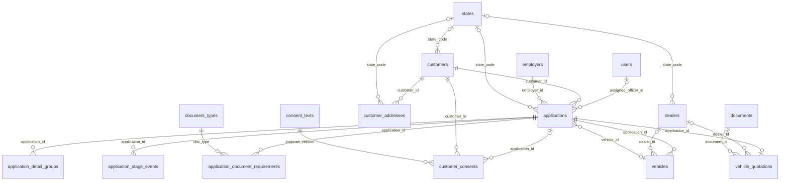

### Documents and KYC

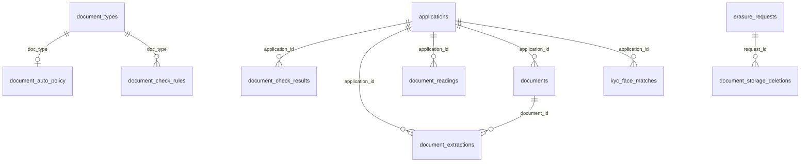

### Credit bureau

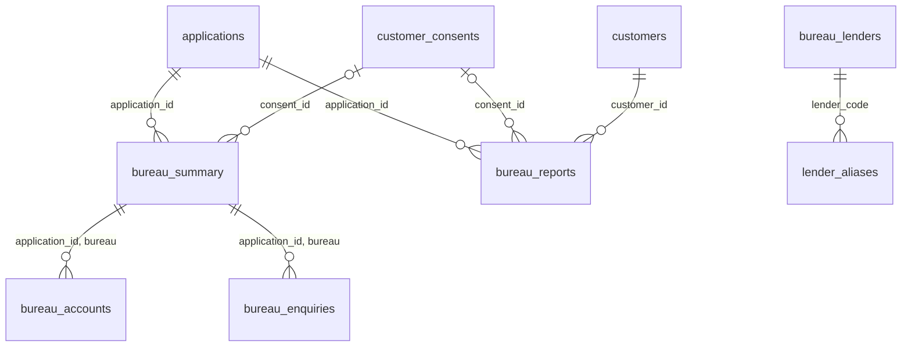

### Income and banking

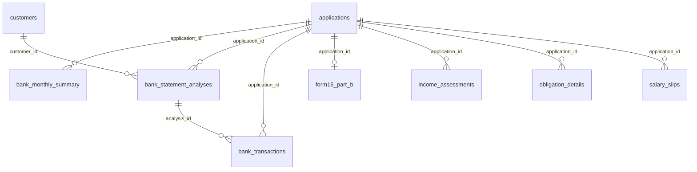

### Employers

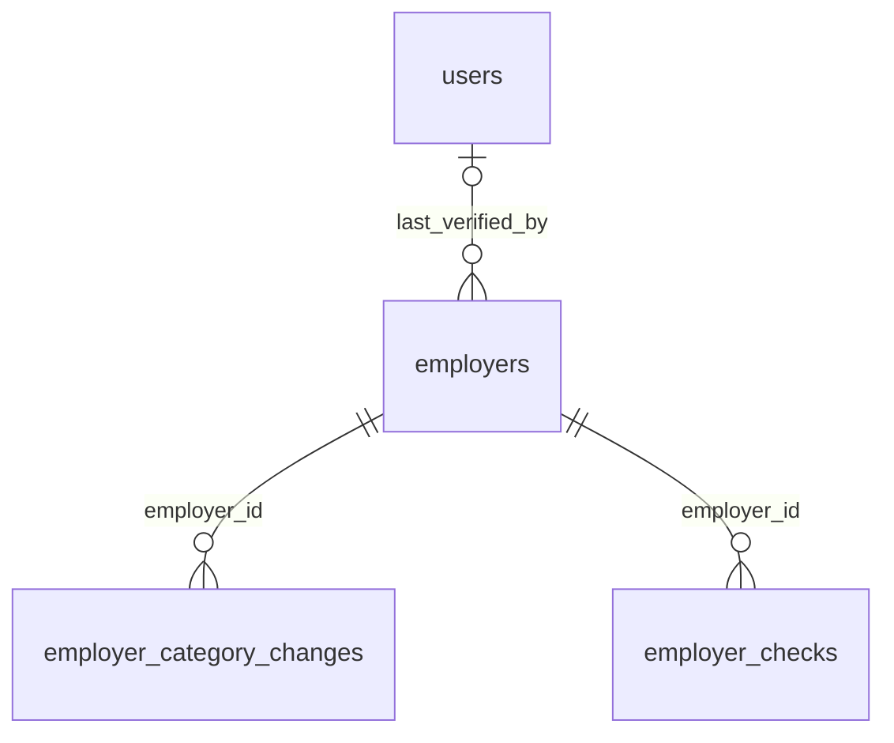

### Policy rules and decisions

```mermaid
erDiagram
    applications ||--o{ credit_decisions : "application_id"
    model_versions |o--o{ credit_decisions : "model_version"
    users |o--o{ credit_decisions : "officer_id"
    policy_versions |o--o{ credit_decisions : "policy_version_id"
    recommendations ||--o{ credit_decisions : "recommendation_id"
    rule_set_snapshots |o--o{ credit_decisions : "rules_snapshot"
    applications ||--o{ engine_decisions : "application_id"
    policy_versions |o--o{ engine_decisions : "policy_version_id"
    applications ||--o{ fraud_signals : "application_id"
    users |o--o{ fraud_signals : "reviewed_by_id"
    applications ||--o{ override_logs : "application_id"
    users |o--o{ override_logs : "approved_by_id"
    credit_decisions ||--o{ override_logs : "decision_id"
    users ||--o{ override_logs : "officer_id"
    policy_versions ||--o{ policy_change_requests : "policy_version_id"
    users |o--o{ policy_change_requests : "requested_by"
    policy_change_requests ||--o{ policy_change_reviews : "change_request_id"
    users ||--o{ policy_change_reviews : "reviewer_id"
    policy_versions ||--o| policy_documents : "policy_version_id"
    parameter_definitions ||--o{ policy_parameters : "param_key"
    policy_versions ||--o{ policy_parameters : "policy_version_id"
    applications ||--o{ policy_results : "application_id"
    reason_codes |o--o{ policy_results : "reason_code"
    policy_rules ||--o{ policy_results : "rule_id"
    reason_codes |o--o{ policy_rules : "reason_code"
    policy_versions |o--o{ policy_simulations : "compared_to_id"
    policy_versions ||--o{ policy_simulations : "policy_version_id"
    users |o--o{ policy_version_events : "actor_id"
    policy_versions ||--o{ policy_version_events : "policy_version_id"
    policy_versions ||--o{ policy_version_rule_changes : "policy_version_id"
    users |o--o{ policy_versions : "approved_by"
    users |o--o{ policy_versions : "authored_by"
    policy_versions |o--o{ policy_versions : "base_version_id"
    tenants ||--o{ policy_versions : "tenant_id"
    applications ||--o{ recommendations : "application_id"
    model_versions |o--o{ recommendations : "model_version"
    policy_versions |o--o{ recommendations : "policy_version_id"
    rule_set_snapshots |o--o{ recommendations : "rules_snapshot"
```

### Pricing and rate grid

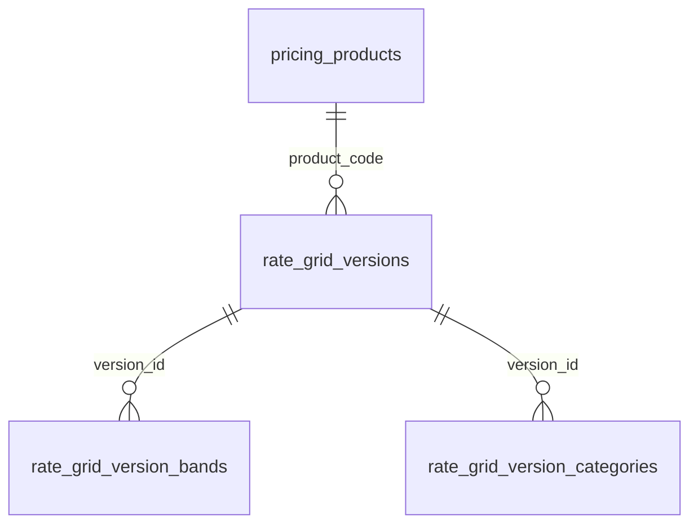

### Loan after approval

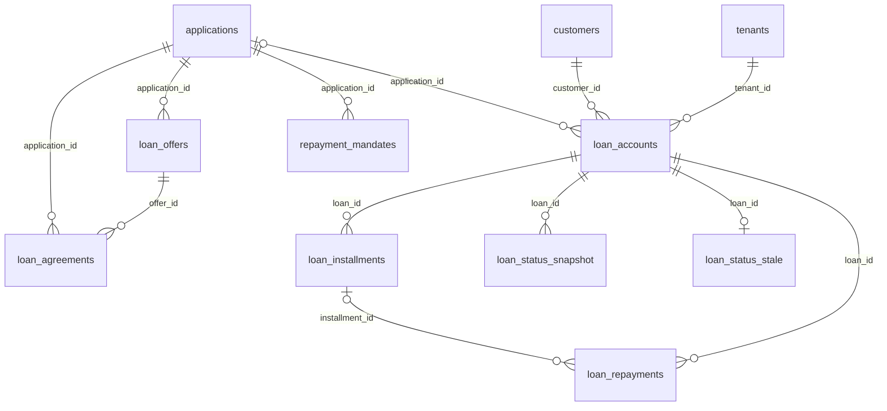

### Risk models

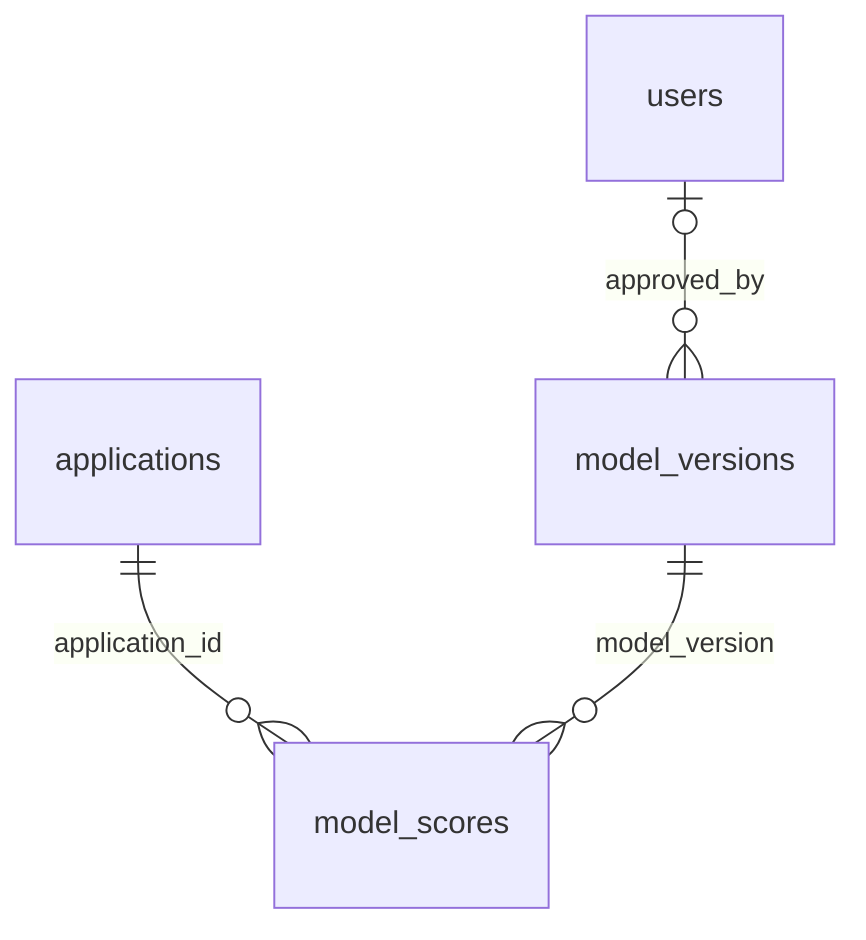

### Staff, roles and access

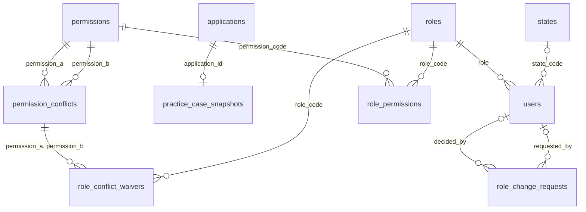

### Audit and data protection

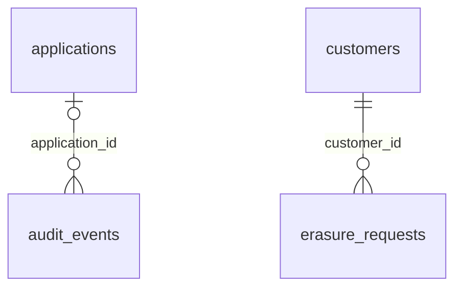

### Platform settings

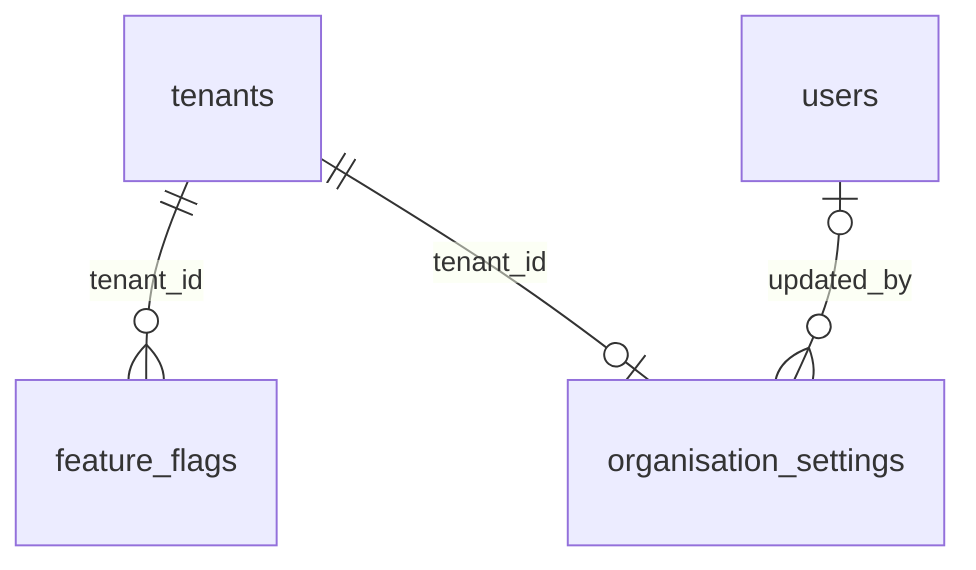

## Every foreign key

| Parent | Child | Child column(s) | Cardinality | Parent | On delete |
|---|---|---|---|---|---|
| `applications` | `application_detail_groups` | `application_id` | one-to-many (1 : 0..N) | required | no action (blocks the delete) |
| `applications` | `application_document_requirements` | `application_id` | one-to-many (1 : 0..N) | required | no action (blocks the delete) |
| `applications` | `application_stage_events` | `application_id` | one-to-many (1 : 0..N) | required | no action (blocks the delete) |
| `applications` | `audit_events` | `application_id` | one-to-many (0..1 : 0..N) | optional | no action (blocks the delete) |
| `applications` | `bank_monthly_summary` | `application_id` | one-to-many (1 : 0..N) | required | cascade (children deleted too) |
| `applications` | `bank_statement_analyses` | `application_id` | one-to-many (1 : 0..N) | required | no action (blocks the delete) |
| `applications` | `bank_transactions` | `application_id` | one-to-many (1 : 0..N) | required | no action (blocks the delete) |
| `applications` | `bureau_reports` | `application_id` | one-to-many (1 : 0..N) | required | no action (blocks the delete) |
| `applications` | `bureau_summary` | `application_id` | one-to-many (1 : 0..N) | required | cascade (children deleted too) |
| `applications` | `credit_decisions` | `application_id` | one-to-many (1 : 0..N) | required | no action (blocks the delete) |
| `applications` | `customer_consents` | `application_id` | one-to-many (0..1 : 0..N) | optional | no action (blocks the delete) |
| `applications` | `document_check_results` | `application_id` | one-to-many (1 : 0..N) | required | no action (blocks the delete) |
| `applications` | `document_extractions` | `application_id` | one-to-many (1 : 0..N) | required | no action (blocks the delete) |
| `applications` | `document_readings` | `application_id` | one-to-many (1 : 0..N) | required | no action (blocks the delete) |
| `applications` | `documents` | `application_id` | one-to-many (1 : 0..N) | required | no action (blocks the delete) |
| `applications` | `engine_decisions` | `application_id` | one-to-many (1 : 0..N) | required | no action (blocks the delete) |
| `applications` | `form16_part_b` | `application_id` | one-to-one (1 : 0..1) | required | cascade (children deleted too) |
| `applications` | `fraud_signals` | `application_id` | one-to-many (1 : 0..N) | required | no action (blocks the delete) |
| `applications` | `income_assessments` | `application_id` | one-to-many (1 : 0..N) | required | no action (blocks the delete) |
| `applications` | `kyc_face_matches` | `application_id` | one-to-many (1 : 0..N) | required | no action (blocks the delete) |
| `applications` | `loan_accounts` | `application_id` | one-to-many (0..1 : 0..N) | optional | no action (blocks the delete) |
| `applications` | `loan_agreements` | `application_id` | one-to-many (1 : 0..N) | required | no action (blocks the delete) |
| `applications` | `loan_offers` | `application_id` | one-to-many (1 : 0..N) | required | no action (blocks the delete) |
| `applications` | `model_scores` | `application_id` | one-to-many (1 : 0..N) | required | no action (blocks the delete) |
| `applications` | `obligation_details` | `application_id` | one-to-many (1 : 0..N) | required | no action (blocks the delete) |
| `applications` | `override_logs` | `application_id` | one-to-many (1 : 0..N) | required | no action (blocks the delete) |
| `applications` | `policy_results` | `application_id` | one-to-many (1 : 0..N) | required | no action (blocks the delete) |
| `applications` | `practice_case_snapshots` | `application_id` | one-to-one (1 : 0..1) | required | cascade (children deleted too) |
| `applications` | `recommendations` | `application_id` | one-to-many (1 : 0..N) | required | no action (blocks the delete) |
| `applications` | `repayment_mandates` | `application_id` | one-to-many (1 : 0..N) | required | no action (blocks the delete) |
| `applications` | `salary_slips` | `application_id` | one-to-many (1 : 0..N) | required | cascade (children deleted too) |
| `applications` | `vehicle_quotations` | `application_id` | one-to-one (1 : 0..1) | required | no action (blocks the delete) |
| `applications` | `vehicles` | `application_id` | one-to-many (1 : 0..N) | required | no action (blocks the delete) |
| `bank_statement_analyses` | `bank_transactions` | `analysis_id` | one-to-many (1 : 0..N) | required | no action (blocks the delete) |
| `bureau_lenders` | `lender_aliases` | `lender_code` | one-to-many (1 : 0..N) | required | no action (blocks the delete) |
| `bureau_summary` | `bureau_accounts` | `application_id, bureau` | one-to-many (1 : 0..N) | required | cascade (children deleted too) |
| `bureau_summary` | `bureau_enquiries` | `application_id, bureau` | one-to-many (1 : 0..N) | required | cascade (children deleted too) |
| `consent_texts` | `customer_consents` | `purpose, version` | one-to-many (1 : 0..N) | required | no action (blocks the delete) |
| `credit_decisions` | `override_logs` | `decision_id` | one-to-many (1 : 0..N) | required | no action (blocks the delete) |
| `customer_consents` | `bureau_reports` | `consent_id` | one-to-many (0..1 : 0..N) | optional | set null (link cleared) |
| `customer_consents` | `bureau_summary` | `consent_id` | one-to-many (0..1 : 0..N) | optional | set null (link cleared) |
| `customers` | `applications` | `customer_id` | one-to-many (1 : 0..N) | required | no action (blocks the delete) |
| `customers` | `bank_statement_analyses` | `customer_id` | one-to-many (1 : 0..N) | required | no action (blocks the delete) |
| `customers` | `bureau_reports` | `customer_id` | one-to-many (1 : 0..N) | required | no action (blocks the delete) |
| `customers` | `customer_addresses` | `customer_id` | one-to-many (1 : 0..N) | required | no action (blocks the delete) |
| `customers` | `customer_consents` | `customer_id` | one-to-many (1 : 0..N) | required | no action (blocks the delete) |
| `customers` | `erasure_requests` | `customer_id` | one-to-many (1 : 0..N) | required | no action (blocks the delete) |
| `customers` | `loan_accounts` | `customer_id` | one-to-many (1 : 0..N) | required | no action (blocks the delete) |
| `dealers` | `vehicle_quotations` | `dealer_id` | one-to-many (0..1 : 0..N) | optional | no action (blocks the delete) |
| `dealers` | `vehicles` | `dealer_id` | one-to-many (0..1 : 0..N) | optional | no action (blocks the delete) |
| `document_types` | `application_document_requirements` | `doc_type` | one-to-many (1 : 0..N) | required | no action (blocks the delete) |
| `document_types` | `document_auto_policy` | `doc_type` | one-to-one (1 : 0..1) | required | no action (blocks the delete) |
| `document_types` | `document_check_rules` | `doc_type` | one-to-many (1 : 0..N) | required | no action (blocks the delete) |
| `documents` | `document_extractions` | `document_id` | one-to-many (1 : 0..N) | required | no action (blocks the delete) |
| `documents` | `vehicle_quotations` | `document_id` | one-to-many (0..1 : 0..N) | optional | no action (blocks the delete) |
| `employers` | `applications` | `employer_id` | one-to-many (0..1 : 0..N) | optional | set null (link cleared) |
| `employers` | `employer_category_changes` | `employer_id` | one-to-many (1 : 0..N) | required | cascade (children deleted too) |
| `employers` | `employer_checks` | `employer_id` | one-to-many (1 : 0..N) | required | cascade (children deleted too) |
| `erasure_requests` | `document_storage_deletions` | `request_id` | one-to-many (1 : 0..N) | required | no action (blocks the delete) |
| `loan_accounts` | `loan_installments` | `loan_id` | one-to-many (1 : 0..N) | required | no action (blocks the delete) |
| `loan_accounts` | `loan_repayments` | `loan_id` | one-to-many (1 : 0..N) | required | no action (blocks the delete) |
| `loan_accounts` | `loan_status_snapshot` | `loan_id` | one-to-many (1 : 0..N) | required | cascade (children deleted too) |
| `loan_accounts` | `loan_status_stale` | `loan_id` | one-to-one (1 : 0..1) | required | cascade (children deleted too) |
| `loan_installments` | `loan_repayments` | `installment_id` | one-to-many (0..1 : 0..N) | optional | no action (blocks the delete) |
| `loan_offers` | `loan_agreements` | `offer_id` | one-to-many (1 : 0..N) | required | no action (blocks the delete) |
| `model_versions` | `credit_decisions` | `model_version` | one-to-many (0..1 : 0..N) | optional | no action (blocks the delete) |
| `model_versions` | `model_scores` | `model_version` | one-to-many (1 : 0..N) | required | no action (blocks the delete) |
| `model_versions` | `recommendations` | `model_version` | one-to-many (0..1 : 0..N) | optional | no action (blocks the delete) |
| `parameter_definitions` | `policy_parameters` | `param_key` | one-to-many (1 : 0..N) | required | no action (blocks the delete) |
| `permission_conflicts` | `role_conflict_waivers` | `permission_a, permission_b` | one-to-many (1 : 0..N) | required | no action (blocks the delete) |
| `permissions` | `permission_conflicts` | `permission_a` | one-to-many (1 : 0..N) | required | no action (blocks the delete) |
| `permissions` | `permission_conflicts` | `permission_b` | one-to-many (1 : 0..N) | required | no action (blocks the delete) |
| `permissions` | `role_permissions` | `permission_code` | one-to-many (1 : 0..N) | required | no action (blocks the delete) |
| `policy_change_requests` | `policy_change_reviews` | `change_request_id` | one-to-many (1 : 0..N) | required | no action (blocks the delete) |
| `policy_rules` | `policy_results` | `rule_id` | one-to-many (1 : 0..N) | required | no action (blocks the delete) |
| `policy_versions` | `credit_decisions` | `policy_version_id` | one-to-many (0..1 : 0..N) | optional | no action (blocks the delete) |
| `policy_versions` | `engine_decisions` | `policy_version_id` | one-to-many (0..1 : 0..N) | optional | no action (blocks the delete) |
| `policy_versions` | `policy_change_requests` | `policy_version_id` | one-to-many (1 : 0..N) | required | no action (blocks the delete) |
| `policy_versions` | `policy_documents` | `policy_version_id` | one-to-one (1 : 0..1) | required | no action (blocks the delete) |
| `policy_versions` | `policy_parameters` | `policy_version_id` | one-to-many (1 : 0..N) | required | no action (blocks the delete) |
| `policy_versions` | `policy_simulations` | `compared_to_id` | one-to-many (0..1 : 0..N) | optional | no action (blocks the delete) |
| `policy_versions` | `policy_simulations` | `policy_version_id` | one-to-many (1 : 0..N) | required | no action (blocks the delete) |
| `policy_versions` | `policy_version_events` | `policy_version_id` | one-to-many (1 : 0..N) | required | no action (blocks the delete) |
| `policy_versions` | `policy_version_rule_changes` | `policy_version_id` | one-to-many (1 : 0..N) | required | cascade (children deleted too) |
| `policy_versions` | `policy_versions` | `base_version_id` | one-to-many (0..1 : 0..N) | optional | no action (blocks the delete) |
| `policy_versions` | `recommendations` | `policy_version_id` | one-to-many (0..1 : 0..N) | optional | no action (blocks the delete) |
| `pricing_products` | `rate_grid_versions` | `product_code` | one-to-many (1 : 0..N) | required | no action (blocks the delete) |
| `rate_grid_versions` | `rate_grid_version_bands` | `version_id` | one-to-many (1 : 0..N) | required | cascade (children deleted too) |
| `rate_grid_versions` | `rate_grid_version_categories` | `version_id` | one-to-many (1 : 0..N) | required | cascade (children deleted too) |
| `reason_codes` | `policy_results` | `reason_code` | one-to-many (0..1 : 0..N) | optional | no action (blocks the delete) |
| `reason_codes` | `policy_rules` | `reason_code` | one-to-many (0..1 : 0..N) | optional | no action (blocks the delete) |
| `recommendations` | `credit_decisions` | `recommendation_id` | one-to-many (1 : 0..N) | required | no action (blocks the delete) |
| `roles` | `role_conflict_waivers` | `role_code` | one-to-many (1 : 0..N) | required | cascade (children deleted too) |
| `roles` | `role_permissions` | `role_code` | one-to-many (1 : 0..N) | required | cascade (children deleted too) |
| `roles` | `users` | `role` | one-to-many (1 : 0..N) | required | no action (blocks the delete) |
| `rule_set_snapshots` | `credit_decisions` | `rules_snapshot` | one-to-many (0..1 : 0..N) | optional | no action (blocks the delete) |
| `rule_set_snapshots` | `recommendations` | `rules_snapshot` | one-to-many (0..1 : 0..N) | optional | no action (blocks the delete) |
| `states` | `applications` | `state_code` | one-to-many (0..1 : 0..N) | optional | no action (blocks the delete) |
| `states` | `customer_addresses` | `state_code` | one-to-many (0..1 : 0..N) | optional | no action (blocks the delete) |
| `states` | `customers` | `state_code` | one-to-many (0..1 : 0..N) | optional | no action (blocks the delete) |
| `states` | `dealers` | `state_code` | one-to-many (0..1 : 0..N) | optional | no action (blocks the delete) |
| `states` | `users` | `state_code` | one-to-many (0..1 : 0..N) | optional | no action (blocks the delete) |
| `tenants` | `feature_flags` | `tenant_id` | one-to-many (1 : 0..N) | required | no action (blocks the delete) |
| `tenants` | `loan_accounts` | `tenant_id` | one-to-many (1 : 0..N) | required | no action (blocks the delete) |
| `tenants` | `organisation_settings` | `tenant_id` | one-to-one (1 : 0..1) | required | no action (blocks the delete) |
| `tenants` | `policy_versions` | `tenant_id` | one-to-many (1 : 0..N) | required | no action (blocks the delete) |
| `users` | `applications` | `assigned_officer_id` | one-to-many (0..1 : 0..N) | optional | no action (blocks the delete) |
| `users` | `credit_decisions` | `officer_id` | one-to-many (0..1 : 0..N) | optional | no action (blocks the delete) |
| `users` | `employers` | `last_verified_by` | one-to-many (0..1 : 0..N) | optional | no action (blocks the delete) |
| `users` | `fraud_signals` | `reviewed_by_id` | one-to-many (0..1 : 0..N) | optional | no action (blocks the delete) |
| `users` | `model_versions` | `approved_by` | one-to-many (0..1 : 0..N) | optional | no action (blocks the delete) |
| `users` | `organisation_settings` | `updated_by` | one-to-many (0..1 : 0..N) | optional | no action (blocks the delete) |
| `users` | `override_logs` | `approved_by_id` | one-to-many (0..1 : 0..N) | optional | no action (blocks the delete) |
| `users` | `override_logs` | `officer_id` | one-to-many (1 : 0..N) | required | no action (blocks the delete) |
| `users` | `policy_change_requests` | `requested_by` | one-to-many (0..1 : 0..N) | optional | no action (blocks the delete) |
| `users` | `policy_change_reviews` | `reviewer_id` | one-to-many (1 : 0..N) | required | no action (blocks the delete) |
| `users` | `policy_version_events` | `actor_id` | one-to-many (0..1 : 0..N) | optional | no action (blocks the delete) |
| `users` | `policy_versions` | `approved_by` | one-to-many (0..1 : 0..N) | optional | no action (blocks the delete) |
| `users` | `policy_versions` | `authored_by` | one-to-many (0..1 : 0..N) | optional | no action (blocks the delete) |
| `users` | `role_change_requests` | `decided_by` | one-to-many (0..1 : 0..N) | optional | no action (blocks the delete) |
| `users` | `role_change_requests` | `requested_by` | one-to-many (0..1 : 0..N) | optional | no action (blocks the delete) |
| `vehicles` | `applications` | `vehicle_id` | one-to-many (0..1 : 0..N) | optional | no action (blocks the delete) |

## Tables with no foreign keys

These stand alone: settings rows, look-up lists, logs keyed by text, or tables the engine links by value rather than by key.

`document_auto_settings`, `bureau_product_map`, `employer_reference_list`, `employer_master_settings`, `employer_category_pricing`, `policy_rule_history`, `rate_grid`, `model_controls`, `security_settings`, `team_reset_accounts`, `team_change_journal`, `audit_chain`, `app_secrets`, `data_protection_settings`, `feature_flag_history`, `simulation_settings`, `sim_daily_runs`, `settings_baselines`, `settings_backups`, `app_feedback`
